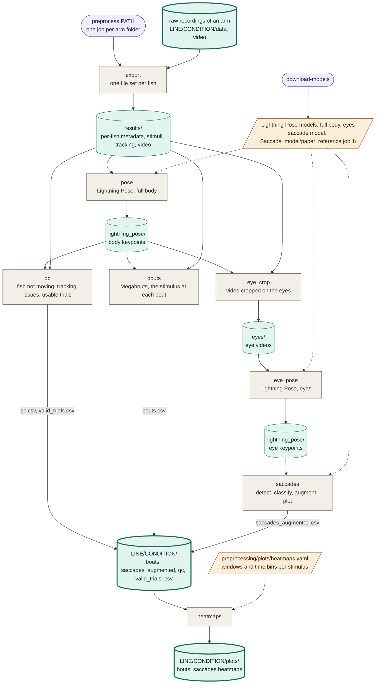
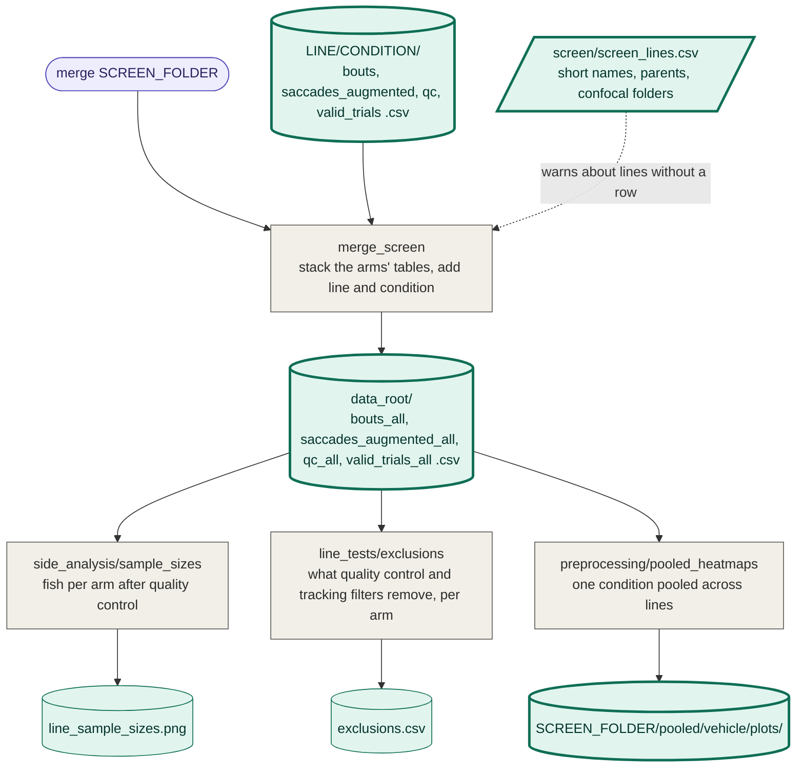
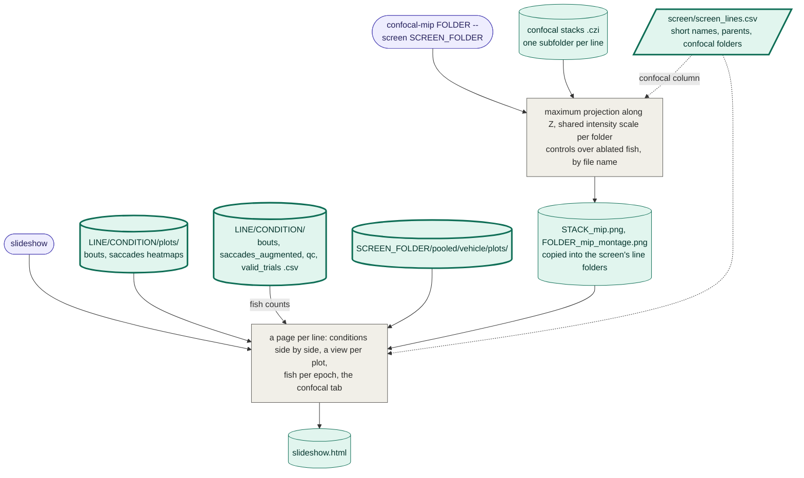
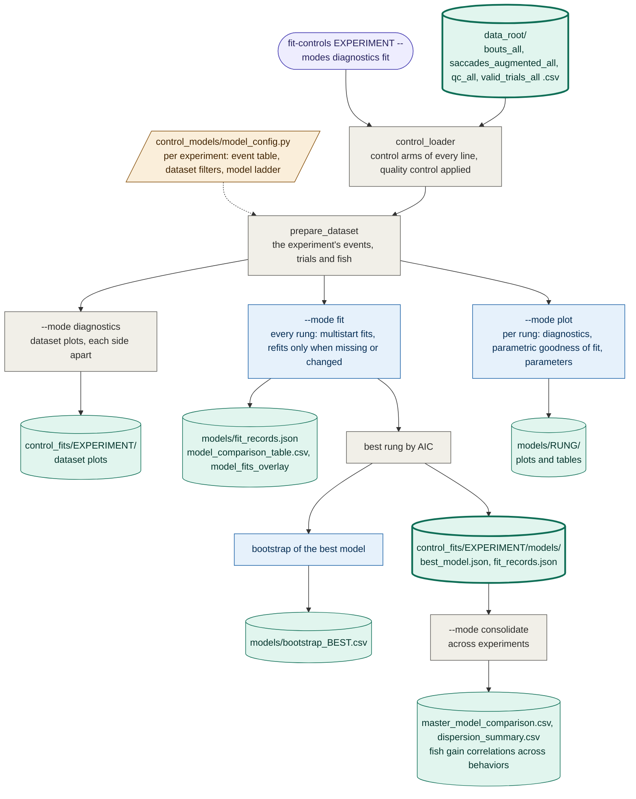
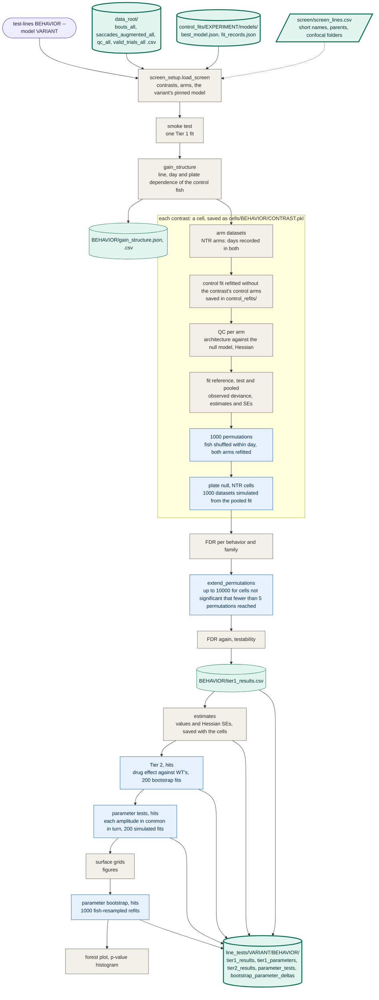
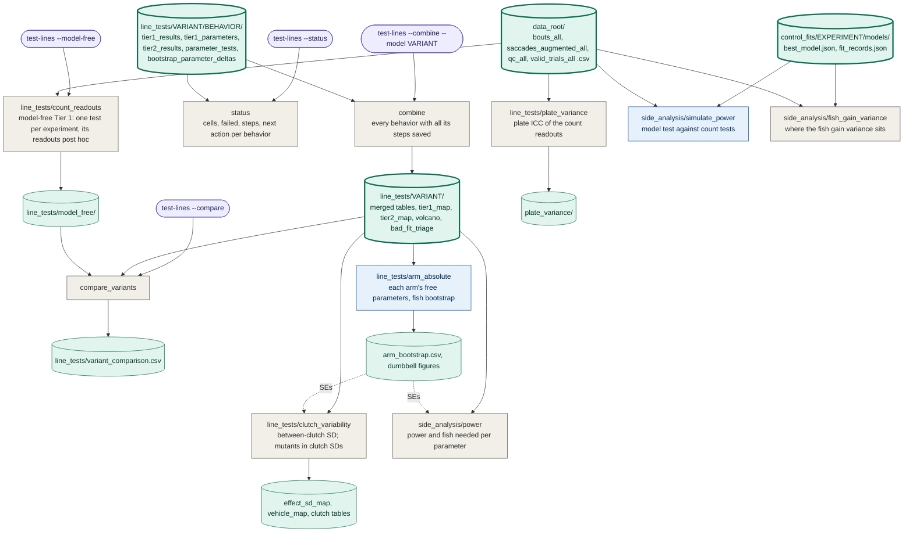

# How the pipeline works

From raw recordings to the line tests, one diagram per stage. Stages hand off through **shared nodes**
(thick teal outline): the same node in two diagrams is the same file or folder. The whole pipeline, stitched from
the stage diagrams, is at the end.

| shape | is |
|---|---|
| stadium, purple | a command: `python -m BehaviorScreen STAGE` |
| rectangle, grey | a step of that command |
| rectangle, blue | a step whose fits run over the worker processes |
| cylinder, green | a file or folder it writes |
| parallelogram, amber | a configuration or model it reads |

`python docs/export_pipeline.py` writes every diagram as a standalone SVG into `docs/svg/` (it needs Node.js).
Edit a stage diagram, then run `python docs/stitch_pipeline.py` to update the whole-pipeline diagram
(`BehaviorScreen/tests/test_pipeline_docs.py` fails while it is out of date). A stage diagram starts with
`%% stage: TITLE` and `%% shared: NODE ...`; declare each node on its own line and write one edge per line
(`a --> b`, `a -->|label| b`, `a -.-> b`).

## 1. Preprocessing: one arm folder at a time

`python -m BehaviorScreen preprocess PATH` submits one job per `LINE/CONDITION` folder (a GPU when the steps
include pose, eye_pose or bouts). The steps run in this order; `--steps` picks some of them, and a step skips
what it has already written (pose: videos with predictions; bouts: recent outputs). `preprocessing/status.py`
(and the GUI) shows, per recording, what each step can work on and what it wrote.

The saccade step runs `preprocessing/saccades/run_analysis.py`: detection on the eye traces, classification with
the reference model built from Dowell et al. 2024 (`paper_reference.py`), the saccade table augmented with the
stimulus (`saccades_augmented.csv`) and the cluster plot.

## 2. Merge and screen-wide tables

`python -m BehaviorScreen merge [SCREEN_FOLDER]` stacks every arm's tables into `TABLE_all.csv` in the machine's
`data_root` (`machines.yaml`), with `line` and `condition` columns. Everything after this reads the merged tables
through `screen/loader.py` (`BehavioralDataLoader`), which applies the quality control (`qc_all.csv`), the usable
trials (`valid_trials_all.csv`) and the tracking filters.

## 3. Slideshow and confocal images

`python -m BehaviorScreen confocal-mip FOLDER` projects each line's confocal stacks; `python -m BehaviorScreen
slideshow` builds one HTML page per line from the arms' heatmaps, with fish counts from the arm tables, the pooled
vehicle page and the confocal montages.

## 4. Control models: one model per behavior, fitted on the controls

`python -m BehaviorScreen fit-controls [EXPERIMENT ...] [--modes diagnostics fit]` submits one job per experiment
and mode. An experiment (`model_config.py`) names its event table, the dataset filters and a ladder of candidate
models, fitted in a fixed order on the control fish of every line (`control_loader`: vehicle and danieau arms).
The best rung by AIC is the model the line tests pin to.

## 5. Line tests: one job per behavior

`python -m BehaviorScreen test-lines [BEHAVIOR ...] [--model best|best-poisson|base] [--resubmit N]` submits
one job per behavior into `line_tests/VARIANT/`. A **cell** is one contrast in one behavior: an NTR line's
vehicle against its ronidazole siblings (fish of the days recorded in both), or a mutant against its background.
Each arm is fitted with the control model, every parameter but the amplitudes pinned (`tier1_config.py`), and
the deviance between separate and pooled fits is tested against fish shuffled between the arms within day.

Everything is saved as it is done, so a resubmitted job resumes: each cell in `cells/BEHAVIOR/`, each control
refit in `control_refits/`, each step after the cells in `BEHAVIOR/STEP.csv` (reused while newer than the cells;
the step under way in `BEHAVIOR/running.txt`). Cells are reused while the model, the control fit and the cell's
fish are the same; a run with another `n_perm` or `n_sim` stops rather than replace them.

The plate null (`p_value_plate`) asks how large the deviance would be with no effect but fish of a plate, a day
and a line as alike as the control fish are: `gain_structure` sets the shares of a fish's gain common to each
level so that control data simulated from the control fit match the controls' intraclass correlations, and each
NTR cell's null is simulated with its own fish, days and plates. A plate holds one arm, so plate effects alone can
separate two arms; the fish-label permutation does not see them.

## 6. Merge the behaviors, then the analyses that read the merged results

`python -m BehaviorScreen test-lines --combine [--model VARIANT]` merges the behaviors whose steps are all saved
and draws the maps. `--model-free` runs the same screen without a model (`count_readouts`: readouts counted per fish,
one test per experiment, its readouts post hoc), one short job. `--status` says, from the results folders alone, what
is saved and what to do next; `--compare` sets the hits of the variants and of the model-free screen side by side.

## The whole pipeline

Stitched from the stage diagrams by `docs/stitch_pipeline.py`: do not edit by hand. Each shared node sits in the
stage that writes it. The diagram is large: zoom in on GitHub, or read the stages above.

```mermaid
flowchart TD
classDef cmd fill:#EEEDFE,stroke:#534AB7,color:#26215C
classDef step fill:#F1EFE8,stroke:#5F5E5A,color:#2C2C2A
classDef par fill:#E6F1FB,stroke:#185FA5,color:#042C53
classDef data fill:#E1F5EE,stroke:#0F6E56,color:#04342C
classDef shared fill:#E1F5EE,stroke:#0F6E56,color:#04342C,stroke-width:3px
classDef config fill:#FAEEDA,stroke:#854F0B,color:#412402
subgraph stage_1["Preprocessing"]
  pre_cmd(["preprocess PATH<br>one job per arm folder"]):::cmd
  dl_cmd(["download-models"]):::cmd
  models[/"Lightning Pose models: full body, eyes<br>saccade model: Saccade_model/paper_reference.joblib"/]:::config
  heat_yaml[/"preprocessing/plots/heatmaps.yaml<br>windows and time bins per stimulus"/]:::config
  raw[("raw recordings of an arm<br>LINE/CONDITION/data, video")]:::shared
  export["export<br>one file set per fish"]:::step
  results[("results/<br>per-fish metadata, stimuli, tracking, video")]:::data
  pose["pose<br>Lightning Pose, full body"]:::step
  lp[("lightning_pose/<br>body keypoints")]:::data
  eye_crop["eye_crop<br>video cropped on the eyes"]:::step
  eyes[("eyes/<br>eye videos")]:::data
  eye_pose["eye_pose<br>Lightning Pose, eyes"]:::step
  lp_eyes[("lightning_pose/<br>eye keypoints")]:::data
  qc["qc<br>fish not moving, tracking issues, usable trials"]:::step
  bouts["bouts<br>Megabouts, the stimulus at each bout"]:::step
  saccades["saccades<br>detect, classify, augment, plot"]:::step
  heatmaps["heatmaps"]:::step
  arm_tables[("LINE/CONDITION/<br>bouts, saccades_augmented, qc, valid_trials .csv")]:::shared
  arm_plots[("LINE/CONDITION/plots/<br>bouts, saccades heatmaps")]:::shared
  pre_cmd --> export
  dl_cmd --> models
  raw --> export
  export --> results
  results --> pose
  models -.-> pose
  pose --> lp
  lp --> eye_crop
  results --> eye_crop
  eye_crop --> eyes
  eyes --> eye_pose
  models -.-> eye_pose
  eye_pose --> lp_eyes
  lp --> qc
  results --> qc
  qc -->|qc.csv, valid_trials.csv| arm_tables
  lp --> bouts
  results --> bouts
  bouts -->|bouts.csv| arm_tables
  lp_eyes --> saccades
  models -.-> saccades
  saccades -->|saccades_augmented.csv| arm_tables
  arm_tables --> heatmaps
  heat_yaml -.-> heatmaps
  heatmaps --> arm_plots
end
subgraph stage_2["Merge"]
  merge_cmd(["merge SCREEN_FOLDER"]):::cmd
  lines_csv[/"screen/screen_lines.csv<br>short names, parents, confocal folders"/]:::shared
  merge_step["merge_screen<br>stack the arms' tables, add line and condition"]:::step
  merged[("data_root/<br>bouts_all, saccades_augmented_all, qc_all, valid_trials_all .csv")]:::shared
  sizes["side_analysis/sample_sizes<br>fish per arm after quality control"]:::step
  sizes_out[("line_sample_sizes.png")]:::data
  excl["line_tests/exclusions<br>what quality control and tracking filters remove, per arm"]:::step
  excl_out[("exclusions.csv")]:::data
  pooled["preprocessing/pooled_heatmaps<br>one condition pooled across lines"]:::step
  pooled_plots[("SCREEN_FOLDER/pooled/vehicle/plots/")]:::shared
  merge_cmd --> merge_step
  lines_csv -.->|warns about lines without a row| merge_step
  merge_step --> merged
  merged --> sizes
  sizes --> sizes_out
  merged --> excl
  excl --> excl_out
  merged --> pooled
  pooled --> pooled_plots
end
subgraph stage_3["Slideshow"]
  mip_cmd(["confocal-mip FOLDER --screen SCREEN_FOLDER"]):::cmd
  slide_cmd(["slideshow"]):::cmd
  czi[("confocal stacks .czi<br>one subfolder per line")]:::data
  mip["maximum projection along Z, shared intensity scale per folder<br>controls over ablated fish, by file name"]:::step
  mips[("STACK_mip.png, FOLDER_mip_montage.png<br>copied into the screen's line folders")]:::data
  slide["a page per line: conditions side by side, a view per plot,<br>fish per epoch, the confocal tab"]:::step
  html[("slideshow.html")]:::data
  mip_cmd --> mip
  czi --> mip
  mip --> mips
  slide_cmd --> slide
  mips --> slide
  slide --> html
end
subgraph stage_4["Control models"]
  fit_cmd(["fit-controls EXPERIMENT --modes diagnostics fit"]):::cmd
  mconfig[/"control_models/model_config.py<br>per experiment: event table, dataset filters, model ladder"/]:::config
  cloader["control_loader<br>control arms of every line, quality control applied"]:::step
  cdataset["prepare_dataset<br>the experiment's events, trials and fish"]:::step
  diag["--mode diagnostics<br>dataset plots, each side apart"]:::step
  diag_out[("control_fits/EXPERIMENT/<br>dataset plots")]:::data
  ladder["--mode fit<br>every rung: multistart fits, refits only when missing or changed"]:::par
  records[("models/fit_records.json<br>model_comparison_table.csv, model_fits_overlay")]:::data
  best["best rung by AIC"]:::step
  control_fits[("control_fits/EXPERIMENT/models/<br>best_model.json, fit_records.json")]:::shared
  cboot["bootstrap of the best model"]:::par
  cboot_out[("models/bootstrap_BEST.csv")]:::data
  rungplot["--mode plot<br>per rung: diagnostics, parametric goodness of fit, parameters"]:::par
  rung_out[("models/RUNG/<br>plots and tables")]:::data
  consolidate["--mode consolidate<br>across experiments"]:::step
  cons_out[("master_model_comparison.csv, dispersion_summary.csv<br>fish gain correlations across behaviors")]:::data
  fit_cmd --> cloader
  mconfig -.-> cdataset
  cloader --> cdataset
  cdataset --> diag
  diag --> diag_out
  cdataset --> ladder
  ladder --> records
  ladder --> best
  best --> control_fits
  best --> cboot
  cboot --> cboot_out
  cdataset --> rungplot
  rungplot --> rung_out
  control_fits --> consolidate
  consolidate --> cons_out
end
subgraph stage_5["Line tests"]
  test_cmd(["test-lines BEHAVIOR --model VARIANT"]):::cmd
  setup["screen_setup.load_screen<br>contrasts, arms, the variant's pinned model"]:::step
  smoke["smoke test<br>one Tier 1 fit"]:::step
  gain_structure["gain_structure<br>line, day and plate dependence of the control fish"]:::step
  gs_out[("BEHAVIOR/gain_structure.json, .csv")]:::data
  subgraph cells["each contrast: a cell, saved as cells/BEHAVIOR/CONTRAST.pkl"]
  arm_data["arm datasets<br>NTR arms: days recorded in both"]:::step
  control_refit["control fit refitted without the contrast's control arms<br>saved in control_refits/"]:::step
  arm_qc["QC per arm<br>architecture against the null model, Hessian"]:::step
  arm_fits["fit reference, test and pooled<br>observed deviance, estimates and SEs"]:::step
  permutations["1000 permutations<br>fish shuffled within day, both arms refitted"]:::par
  plate_null["plate null, NTR cells<br>1000 datasets simulated from the pooled fit"]:::par
  end
  fdr["FDR per behavior and family"]:::step
  extend["extend_permutations<br>up to 10000 for cells not significant that fewer than 5 permutations reached"]:::par
  fdr_again["FDR again, testability"]:::step
  tier1[("BEHAVIOR/tier1_results.csv")]:::data
  estimates["estimates<br>values and Hessian SEs, saved with the cells"]:::step
  tier2["Tier 2, hits<br>drug effect against WT's, 200 bootstrap fits"]:::par
  posthoc["parameter tests, hits<br>each amplitude in common in turn, 200 simulated fits"]:::par
  grids["surface grids<br>figures"]:::step
  pboot["parameter bootstrap, hits<br>1000 fish-resampled refits"]:::par
  checks["forest plot, p-value histogram"]:::step
  behavior_tables[("line_tests/VARIANT/BEHAVIOR/<br>tier1_results, tier1_parameters, tier2_results, parameter_tests, bootstrap_parameter_deltas")]:::shared
  test_cmd --> setup
  setup --> smoke
  smoke --> gain_structure
  gain_structure --> gs_out
  gain_structure --> arm_data
  arm_data --> control_refit
  control_refit --> arm_qc
  arm_qc --> arm_fits
  arm_fits --> permutations
  permutations --> plate_null
  plate_null --> fdr
  fdr --> extend
  extend --> fdr_again
  fdr_again --> tier1
  tier1 --> estimates
  estimates --> tier2
  tier2 --> posthoc
  posthoc --> grids
  grids --> pboot
  pboot --> checks
  tier1 --> behavior_tables
  estimates --> behavior_tables
  tier2 --> behavior_tables
  posthoc --> behavior_tables
  pboot --> behavior_tables
end
subgraph stage_6["Merged results and follow-ups"]
  combine_cmd(["test-lines --combine --model VARIANT"]):::cmd
  status_cmd(["test-lines --status"]):::cmd
  compare_cmd(["test-lines --compare"]):::cmd
  model_free_cmd(["test-lines --model-free"]):::cmd
  combine["combine<br>every behavior with all its steps saved"]:::step
  line_results[("line_tests/VARIANT/<br>merged tables, tier1_map, tier2_map, volcano, bad_fit_triage")]:::shared
  status["status<br>cells, failed, steps, next action per behavior"]:::step
  compare["compare_variants"]:::step
  compare_out[("line_tests/variant_comparison.csv")]:::data
  arm_absolute["line_tests/arm_absolute<br>each arm's free parameters, fish bootstrap"]:::par
  arm_out[("arm_bootstrap.csv, dumbbell figures")]:::data
  clutch["line_tests/clutch_variability<br>between-clutch SD; mutants in clutch SDs"]:::step
  clutch_out[("effect_sd_map, vehicle_map, clutch tables")]:::data
  power["side_analysis/power<br>power and fish needed per parameter"]:::step
  counts["line_tests/count_readouts<br>model-free Tier 1: one test per experiment, its readouts post hoc"]:::step
  counts_out[("line_tests/model_free/")]:::data
  plate_var["line_tests/plate_variance<br>plate ICC of the count readouts"]:::step
  plate_out[("plate_variance/")]:::data
  sim_power["side_analysis/simulate_power<br>model test against count tests"]:::par
  gain_var["side_analysis/fish_gain_variance<br>where the fish gain variance sits"]:::step
  combine_cmd --> combine
  combine --> line_results
  status_cmd --> status
  compare_cmd --> compare
  line_results --> compare
  compare --> compare_out
  line_results --> arm_absolute
  arm_absolute --> arm_out
  line_results --> clutch
  arm_out -.->|SEs| clutch
  clutch --> clutch_out
  line_results --> power
  arm_out -.->|SEs| power
  model_free_cmd --> counts
  counts --> counts_out
  counts_out --> compare
  plate_var --> plate_out
end
arm_tables --> merge_step
lines_csv -.->|confocal column| mip
arm_plots --> slide
arm_tables -->|fish counts| slide
pooled_plots --> slide
lines_csv -.-> slide
merged --> cloader
merged --> setup
control_fits --> setup
lines_csv -.-> setup
behavior_tables --> combine
behavior_tables --> status
merged --> counts
merged --> plate_var
control_fits --> sim_power
merged --> sim_power
control_fits --> gain_var
merged --> gain_var
```

<!-- stitched: begin -->

<!-- stitched: end -->
